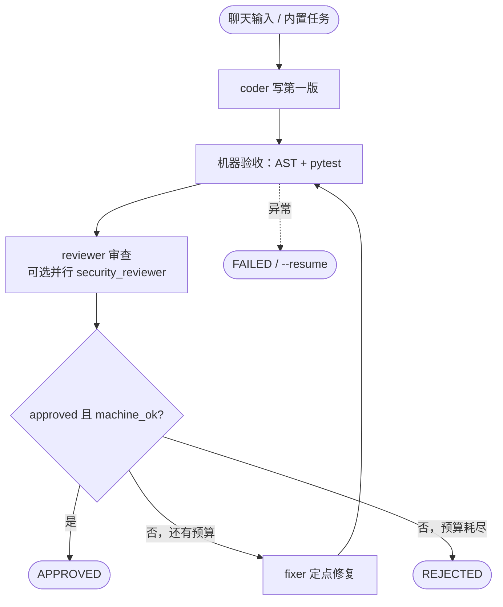
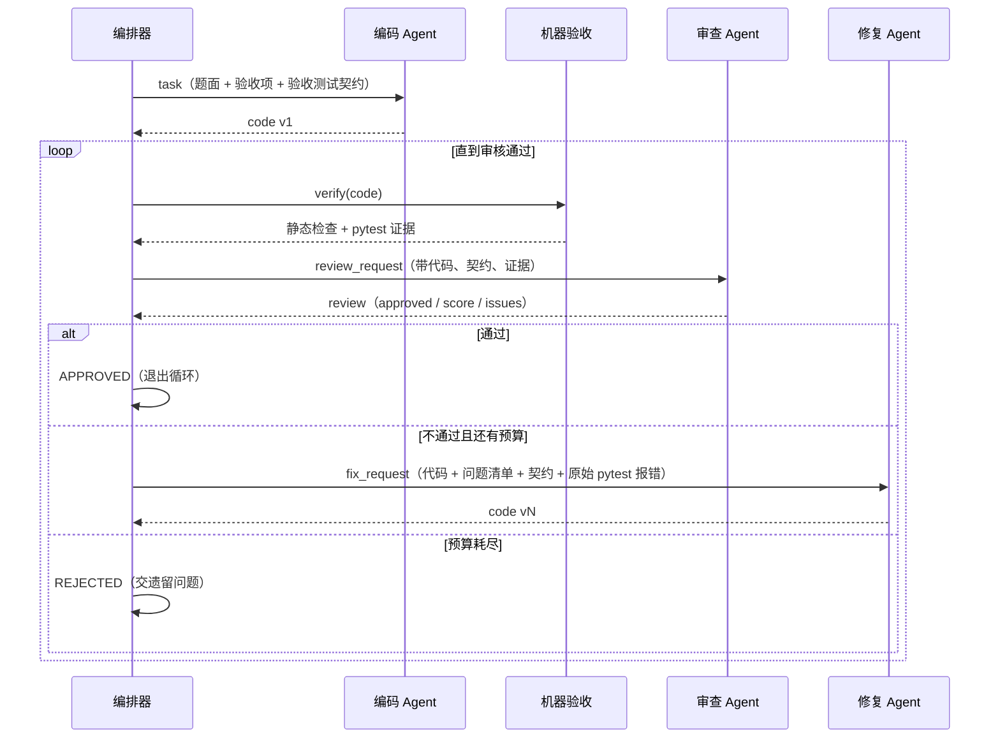

# 设计文档 · 三 Agent 代码审查循环工作流

> 配套阅读：`README.md`（项目说明与使用方法）、`DECISIONS.md`（每条决策的依据）。
> 本文回答四个问题：**系统由什么组成**、**循环体怎么运转**、**出错/中断怎么办**、**怎么验证它真的在工作**。

- 版本：v2（循环体版）
- 日期：2026-10-25
- 核心变更：把「编码 → 审查 → 修复」从一次性直线调用，改为**一个循环体，直到代码审核通过**（DEC-014）

---

## 1. 项目说明

### 1.1 一句话

给定一个编码任务（示例：带过期时间的 LRU 缓存），三个相互独立的 Agent 通过消息总线协作：
编码 Agent 写第一版 → **循环体**里审查 Agent 逐条对照验收项给结论、机器验收用 AST + pytest 给客观证据，
不通过则修复 Agent 定点修复，**重复这一循环直到审核通过**，或轮次预算耗尽熔断。

两个入口共用同一套代码：双击 `WorkflowPanel.exe`（桌面面板），或
`python -m workflow.cli`（命令行，也是面板内部真正执行的东西）。

### 1.2 为什么选「代码审查」这个流程

作业给了几个模板，选代码审查的理由是它**自带客观判据**：代码对不对，跑测试就知道。
这让「工作流是否真的有效」可被机器验证，而不是靠 Agent 自己说「我做完了」。

### 1.3 角色分工

| 角色 | 是谁 | 职责 | 输入 | 输出 |
| --- | --- | --- | --- | --- |
| 编排器 | `workflow/orchestrator.py` | 持有循环体与状态，决定「再来一轮还是收工」 | 各 Agent 的回复 | 消息、状态、DEC、报告 |
| 编码 Agent | `agents/coder.py` | 按任务说明写第一版完整实现 | `task` 消息 | `code` 消息 |
| 审查 Agent | `agents/reviewer.py` | 逐条对照 REQ 审查，输出结构化 JSON | `review_request`（含机器验收证据） | `review` 消息 |
| 修复 Agent | `agents/fixer.py` | 只改被指出的问题，保持结构 | `fix_request`（代码 + 问题清单） | `code` 消息 |
| 机器验收 | `core/verify.py` | AST 静态检查 + 干净工作区跑 pytest | 代码 | 结构化验收证据 |

Agent 的共同点：**无状态、不碰文件系统、只读写自己的收件箱**，因此可以单独替换、单独测试。

---

## 2. 需求对照

### 2.1 必须实现

| 技术要求 | 实现 | 可指认的证据 |
| --- | --- | --- |
| 至少 2 个 Agent 协作完成一个完整流程 | 3 个 Agent（编码 / 审查 / 修复）+ 1 个机器验收 | `agents/coder.py`、`reviewer.py`、`fixer.py`、`core/verify.py` |
| Agent 间的消息传递或状态共享 | 收件箱式消息总线，所有消息落 `messages.jsonl`；单一状态源 `state.json` | `core/bus.py`、`core/state.py`、`runs/<id>/messages.jsonl` |
| 支持基本的流程控制（顺序执行） | 编排器单线程顺序调度：编码 → 循环（审查 → 修复） | `Orchestrator._loop_until_approved()` |
| MVP 可运行即可 | 一条命令离线跑通，无需 API Key | `python -m workflow.cli run --task ttl_cache --mock` |

### 2.2 推荐实现

| 推荐项 | 是否实现 | 实现方式 / 说明 |
| --- | --- | --- |
| 条件分支 | ✅ | 审查结论 + 机器验收 → 三路分支（`approved` / `retry` / `rejected`），见 §3.3 |
| 循环 | ✅ | 显式 `while` 循环体，直到审核通过或预算耗尽（DEC-014） |
| 并行执行 | ✅ | `--parallel-review`：主审查 + 安全审查两个 Agent 线程池并发，join 后取交集（DEC-016） |
| 可视化 Workflow 编排界面 | ✅ | **聊天式面板**（exe）：输入需求 → 逐条渲染「编码 / 机器验收 / 审查 / 分支 / 修复 / 通过」，实时事件驱动（DEC-015、DEC-016） |
| 执行日志与状态追踪 | ✅ | `messages.jsonl` / `decisions.jsonl` / `state.json` / `loop_trace` / `REPORT.md` |
| 错误处理与恢复 | ✅ | 异常→`FAILED` 并落盘；`--resume` 断点续跑；LLM 调用重试；轮次预算熔断 |

---

## 3. 设计

### 3.0 流程图





### 3.1 分层

```
┌──────────────────────────────────────────────────────────────┐
│ workflow/        编排层：循环体、状态机、轮次预算、报告         │
│   orchestrator.py  task.py  report.py  cli.py                │
├──────────────────────────────────────────────────────────────┤
│ agents/          Agent 层：读消息 → 组 Prompt → 回复           │
│   base.py  coder.py  reviewer.py  fixer.py                   │
├──────────────────────────────────────────────────────────────┤
│ core/            基础设施：模型 / 消息总线 / 状态 / DEC / 验收  │
│   llm_client.py  bus.py  state.py  dec.py  verify.py         │
└──────────────────────────────────────────────────────────────┘
```

依赖方向严格单向：`workflow → agents → core`。`core` 不 import 上层，
所以 Agent 可以脱离编排器单独喂消息测试，`core/verify.py` 也能被 CLI 的 `verify` 子命令独立使用。

### 3.2 循环体（本设计的核心）

**问题**：审查结论是运行时才知道的，用「固定步数、每个 Agent 调一次」的直线流程无法表达
「直到通过为止」。**方案**：把「审查 + 分支 + 修复」放进一个 `while`，由审查结论驱动循环条件。

```python
# workflow/orchestrator.py::Orchestrator._loop_until_approved
if state.phase == Phase.FIXING:      # 续跑：先把上一轮没做完的修复补完
    self._phase_fix(state)

while state.phase == Phase.REVIEWING:
    round_no = state.round + 1
    verdict = self._phase_review(state)   # ① 审查 + 条件分支（返回 approved / rejected / retry）
    self._trace_loop(state, round_no, verdict)  # ② 本轮结果写入 loop_trace
    if verdict != VERDICT_RETRY:
        break                             # ③ 通过或熔断 → 离开循环
    self._phase_fix(state)                # ④ 未通过 → 修复 → 回到 while 条件
```

循环体只回答「继续还是离开」，业务判定全部在 `_phase_review` 里。这样做的收益：

- **单一出口判断点**：想改收敛策略（分数阈值、人工审核）只改 `_phase_review`，循环骨架不动；
- **可测**：注入脚本化模型就能断言「第 N 轮通过 → 循环恰好执行 N 次」；
- **可观测**：每轮的 LLM 结论、机器结论、分支动作都进 `loop_trace`。

### 3.3 一次迭代（一轮）的时序

```
编排器                                  审查 Agent            修复 Agent
  │                                          │                     │
  ├─ verify(code) ──► AST 检查 + pytest      │                     │
  │                                          │                     │
  ├─ publish review_request（带验收证据）──►  │                     │
  │                                          ├─ 逐条对照 REQ       │
  │  ◀────────────────────── review(JSON) ──┤ normalize_review    │
  │                                          │  （high 问题强制驳回）│
  ├─ 分支判断：                               │                     │
  │   approved 且 machine_ok → APPROVED（离开循环）                  │
  │   不通过且 round < max_rounds → FIXING ────────────────────────►│
  │                                          │   publish fix_request ├─ 只改问题清单
  │  ◀─────────────────────────────────────── code（v2）────────────┤
  └─ 回到 while 条件 ───────────────────────────────────────────────┘
```

分支表：

| verdict | 条件 | 动作 | 去向 |
| --- | --- | --- | --- |
| `approved` | LLM 通过 **且** 机器验收通过 | 记 DEC | `APPROVED`，离开循环 |
| `retry` | 不通过，且 `round < max_rounds` | 记 DEC，派修复 | 修复后回到循环开头 |
| `rejected` | 不通过，且 `round >= max_rounds` | 记 DEC「熔断」，交出遗留问题 | `REJECTED`，离开循环 |
| （异常） | 调用/解析/验收抛异常 | 记 DEC「运行异常终止」 | `FAILED`，可 `--resume` |

> 特别注意「LLM 说通过、机器说不过」的冲突：以机器为准（DEC-006）。该判定在三层都有一道保险
> ——审查 Prompt 里给证据、`normalize_review` 里改结论、编排器里守终态。

### 3.4 消息协议

每条消息：`msg_id / run_id / seq / sender / recipient / kind / round / payload / ts`。

| kind | 发送方 → 接收方 | 关键字段 |
| --- | --- | --- |
| `task` | 编排器 → 编码 | `task_spec`、`requirements`、`test_contract`、`target_file` |
| `code` | 编码/修复 → 编排器 | `code`、`notes`、`addressed`、`author` |
| `review_request` | 编排器 → 审查 | `code`、`requirements`、`test_contract`、`verification`、`previous_issues` |
| `review` | 审查 → 编排器 | `approved`、`score`、`issues[]`、`summary` |
| `fix_request` | 编排器 → 修复 | `code`、`issues[]`、`requirements`、`test_contract`、`verification` |
| `status` / `done` / `failed` | 编排器 → 全部 | `phase`、`round` |

`issues[]` 每项：`{id, severity, requirement, location, problem, suggestion}`。

### 3.5 状态与循环轨迹

`WorkflowState` 是唯一真相源，每次迁移后原子落盘（临时文件 + `os.replace`），
进程被 kill 也不会写出半个 JSON。

| 字段 | 含义 |
| --- | --- |
| `phase` / `round` / `max_rounds` | 当前阶段、已审查轮次、预算 |
| `code` / `code_version` | 当前代码与版本号（每轮修复 +1） |
| `verification` | 本轮机器验收证据（静态检查项 + pytest 输出） |
| `review` / `reviews` | 本轮 / 历史审查结论 |
| `issues_open` / `issues_resolved` | 未关闭 / 已修复的问题 |
| `loop_trace` | **循环轨迹**：每轮 `iteration / round / approved / machine_ok / score / issues / verdict / action` |
| `error` | 失败原因（成功时为空） |

状态机（迁移白名单 `Phase.TRANSITIONS`）：

```
INIT ──▶ CODING ──▶ REVIEWING ──┬─▶ APPROVED
                                ├─▶ FIXING ──▶ REVIEWING
                                └─▶ REJECTED
任意阶段 ──异常──▶ FAILED
```

约定：**循环体负责「要不要再来一轮」，状态机负责「这次迁移合不合法」**，两者不越界。
非法迁移（如 `REVIEWING → CODING`）直接抛 `IllegalTransition`。

### 3.6 机器验收

| 关卡 | 做什么 | 硬性？ |
| --- | --- | --- |
| 静态检查（AST） | 类/方法是否存在、get/put 签名、是否真用 `with self._lock`、get/put 内有无全表扫描/排序 | 前四项硬性，后两项降级为警告 |
| 动态验收 | 在**干净工作区**铺设代码 + 测试，跑 pytest（超时 180s 视为死锁） | 硬性 |

结果作为「证据」放进审查 Prompt，同时参与编排器的终态判定。
这样避免两种失效：LLM 误放行（测试红也说过）、LLM 误杀（风格问题判不通过）。

### 3.6.1 验收契约：把「测试怎么写」也交给 Agent

机器验收跑的是 `tests/` 里的真实用例，而接口细节（`TTLCache(..., clock=clock)`、
`get(key, default)`、`purge_expired()` / `stats()` / `items()` / `clear()`、内部的 `_expiry`）
只写在测试里。第一版实现据题面猜签名，就会出现「静态检查全绿、pytest 全 ERROR」的死循环：
修复 Agent 只拿到「构造函数 TypeError」这种转述，改不动真正的关键字参数。

所以 `Task.contract_text` 把**验收测试本身**做成契约，随 `task` / `review_request` /
`fix_request` 一起下发，并附一段 AST 自动抽取的接口清单：

```
- 构造签名必须接受这些关键字参数：TTLCache(capacity=..., ttl_seconds=..., clock=...)
- 实例上会出现这些方法调用：put, get, items, stats, clear, purge_expired
- 测试会直接读这些内部属性（名字不能改）：_expiry
```

聊天入口更进一步：需求里点名了已知任务的类名（「… class TTLCache」）时，
`Task.from_prompt` 在**编码之前**就沿用该任务的模块名、REQ 与测试套件，
首轮 Prompt 就带着契约，而不是等第一版跑挂了才 `infer_tests`。

修复 Agent 另外拿到上一轮 pytest 输出的**头尾**（第一个失败用例的完整 traceback +
失败清单）：pytest 会把每行尾部截断成 `…`，只给尾部等于把异常消息丢掉。

### 3.7 错误处理与恢复

| 场景 | 处理 | 恢复手段 |
| --- | --- | --- |
| LLM 网络/限流/5xx | 指数退避重试（默认 2 次），失败抛 `LLMError` | 换成 `--mock`，或稍后 `--resume` |
| 鉴权失败（401/403） | 直接抛错，不重试 | 配 `.env` 的 `AGENT_API_KEY` |
| 模型输出被截断/没代码块/JSON 解析失败 | 抛 `WorkflowError`，**不静默写入半份代码** | 调大 `max_tokens`、换模型、`--resume` |
| pytest 超时 | 判定失败并标注「疑似死锁」 | 看 `runs/<id>/workspace` 手工复现 |
| 审查始终不通过 | `max_rounds` 熔断 → `REJECTED`，保留最后一版代码与问题清单 | 人工介入，或 `--rounds 5` 重跑 |
| 进程中断 / 崩溃 | 每次状态迁移已原子落盘，阶段保存在 `state.json` | `--resume --run-id <id>`，续跑会记一条 DEC |
| 非法状态迁移 | 抛 `IllegalTransition` | 不要手改 `state.json` |

### 3.8 桌面入口（exe 面板）

```
WorkflowPanel.exe  ──无参数──▶ Tkinter 面板（launcher/panel.py）
                   ──--cli───▶ workflow.cli（子进程里跑工作流）
                   ──--pytest▶ pytest.main（给 core/verify 在打包环境里用）
```

面板用**子进程**跑工作流：不卡界面、「停止」能杀掉整个进程树、每次运行都是干净进程。
打包后的两个坑用两条约定补上（DEC-015）：

| 坑 | 约定 |
| --- | --- |
| `sys.executable` 变成面板自己，`python -m pytest` 失效 | `verify._pytest_command()` 检测 `sys.frozen`，改调 `exe --pytest …` |
| `__file__` 指向解包临时目录，`runs/` 会丢 | `core.paths.app_root()` 统一解析：`WORKFLOW_HOME` → exe 目录/上一级（含 `tasks/`）→ 解包目录 |

面板是聊天式的：输入一句需求就开跑，编排器把 `session / code / verification / review / loop / done`
事件推回来，面板逐条渲染成对话（代码预览、验收证据、问题清单、分支、终态）。
斜杠指令覆盖日常配置：`/help`、`/bind`（写 `.env`、回显脱敏）、`/unbind`、`/test`（链路自检：文件 /
目录 / 配置 / Key / 模型连通 / pytest）、`/status`、`/model`、`/base`、`/rounds`、`/parallel`、
`/run`、`/report`、`/version`、`/clear`、`/stop`（DEC-016、DEC-018）。
**面板固定 live，离线 mock 已禁用**：没有 Key 时 `/test` 会直接指出并给出 `/bind` 建议。

### 3.9 可观测性

一次运行产出：

```
runs/<run_id>/
├── state.json          状态真相源（含 loop_trace）
├── messages.jsonl      全部 Agent 消息（按 seq 有序）
├── decisions.jsonl     运行级 DEC 正文
├── DECISIONS.md        运行级 DEC 索引表
├── REPORT.md           一页式报告（验收 / 审查 / 循环轨迹 / DEC / 通信 / 调用 / 最终代码）
├── artifacts/          v1-coder.py、v2-fixer.py、latest.py
└── workspace/          跑 pytest 的干净工作区（每轮重建）
```

`REPORT.md` 的「循环轨迹」表把「第几次、LLM 怎么判、机器怎么判、走了哪个分支」一屏讲清，
这正是从「单次调用」升级到「循环体」后新增的观测面。

---

## 4. 使用方法

### 4.1 安装

```powershell
python -m pip install -r requirements.txt   # requests + pytest
```

### 4.2 双击面板（推荐）

双击 `WorkflowPanel.exe` → 选任务/模式 → 「▶ 运行工作流」。日志实时回显，
结束状态显示「完成 · 通过 ✅ / 未通过 ❌」与退出码。首次使用若没有 `WorkflowPanel.exe`，
先执行一次 `scripts\build_exe.ps1`（或直接 `python launcher\app.py` 用源码开面板）。

### 4.3 离线跑通（不需要 API Key）

```powershell
python -m workflow.cli run --task ttl_cache --mock
```

预期：2 轮通过（第 1 轮被打回 6 条问题，修复后第 2 轮 97 分通过），退出码 0。

### 4.4 接真实模型

```powershell
Copy-Item .env.example .env      # 填 AGENT_API_KEY
python -m workflow.cli run --task ttl_cache --live --rounds 3 --apply
```

`--apply` 只在 `APPROVED` 时把产物写入 `solutions/`。

### 4.5 其他命令

```powershell
python -m workflow.cli tasks                   # 列出任务
python -m workflow.cli verify --task ttl_cache # 只跑双层验收，不起 Agent
python -m workflow.cli runs                    # 历史运行
python -m workflow.cli run --task ttl_cache --resume --run-id <id>   # 断点续跑
python -m pytest -q                            # 43 passed
powershell -NoProfile -ExecutionPolicy Bypass -File .\scripts\build_exe.ps1  # 重新打包 exe
```

### 4.6 参数速查

| 参数 | 作用 |
| --- | --- |
| `--mock` / `--live` | 离线脚本化 / 真实模型 |
| `--rounds N` | 覆盖 `max_rounds`（默认 3） |
| `--resume --run-id <id>` | 从 `state.json` 续跑 |
| `--apply` | 通过后写入 `solutions/` |
| `--no-dynamic-verify` | 只做静态检查，跳过 pytest |
| `--config` / `--model` / `--base-url` | 覆盖配置 |

---

## 5. 失败模式与设计取舍

| 失败模式 | 为什么会发生 | 设计上的应对 |
| --- | --- | --- |
| LLM 误放行 | 审查模型顺着代码说好话 | 机器验收优先（DEC-006） |
| 修复引入回归 | 让编码 Agent 整份重写 | 修复 Agent 只对问题清单负责（DEC-002） |
| 回路不收敛 | 审不过 → 修 → 又不过 | 显式循环 + 轮次预算熔断（DEC-011、DEC-014） |
| 循环说不清 | 重试逻辑埋在状态迁移里 | 循环体一等公民 + `loop_trace`（DEC-014） |
| 崩了不知道跑到哪 | 内存状态丢失 | 原子落盘 + `--resume`（DEC-004） |
| 结论无法复盘 | 只有最后一份代码 | 消息流水 + 运行级 DEC + 报告（DEC-012） |

当前的边界：单机、单写者、按轮次计费；扩展点（并行审查、人工节点、测试生成）见 §8。

---

## 6. 测试与验证

| 测试文件 | 用例数 | 验证什么 |
| --- | --- | --- |
| `tests/test_ttl_cache.py` | 25 | 缓存实现的 6 条验收项（假时钟，不 flaky） |
| `tests/test_workflow_loop.py` | 5 | 循环重复到通过、预算耗尽熔断、机器优先于 LLM、从 CODING / FIXING 续跑 |
| `tests/test_launcher_panel.py` | 21 | 聊天面板：命令拼装、发送流程、事件渲染、斜杠指令、脱敏、忙碌态 |
| `tests/test_prompt_mode.py` | 3 | 一次性任务落盘、`infer_tests` 复用已知测试、事件流顺序 |
| `tests/test_parallel_review.py` | 3 | 并行审查：一票驳回即驳回、全通过才通过、顺序模式只调一个审查员 |
| `tests/test_extensibility.py` | 3 | 注册表暴露内置 Agent、自定义 Agent 加入循环、配置换主审查 |
| `tests/test_contract_prompt.py` | 4 | 验收契约：聊天任务编码前挂载已知套件、编码/修复/审查都收到契约、fixer 收到原始 pytest 报错 |

循环体的五个用例都用**脚本化假模型**（`Orchestrator(llm=...)` 注入），不触网、不花钱，
可以精确控制「第几轮通过」，因此断言是确定性的：

```
test_loop_repeats_until_review_passes             驳回2次→第3次通过：循环3次、修复2次
test_loop_stops_at_round_budget                   max_rounds=2 必熔断，且最后不再修复
test_machine_verdict_keeps_loop_running_when_llm_says_ok   LLM 说通过也不能退出循环
test_resume_from_coding_redoes_first_version      停在编码阶段：续跑重新出第一版
test_resume_from_fixing_finishes_fix_then_loops   停在修复阶段：续跑先补完修复，再回到审查循环
```

---

## 7. 关键决策索引

| 编号 | 主题 | 一句话 |
| --- | --- | --- |
| DEC-002 | 拓扑 | 三 Agent，定点修复而非重写 |
| DEC-004 | 状态 | 单一状态源 + 原子落盘 + 迁移白名单 |
| DEC-006 | 验收 | 机器优先于 LLM |
| DEC-011 | 预算 | 3 轮上限熔断 |
| DEC-014 | 流程控制 | 显式循环体直到审核通过 + 循环轨迹 |
| DEC-015 | 桌面入口 | 单文件 exe + 三子命令，根目录统一解析 |
| DEC-016 | 聊天入口 | `--prompt` 一次性任务 + `--events` 事件流 + 并行审查 |
| DEC-017 | 可扩展性 | Agent 注册表 + 配置驱动流水线 |
| DEC-019 | 验收契约 | 测试源码 + 接口清单随 Prompt 下发；聊天任务编码前挂载已知套件 |

完整列表见 `DECISIONS.md`。

---

## 8. 扩展点

**新增 Agent 不需要改编排器**。`agents/registry.py` 是「名字 → 构造函数」的注册表，
`Orchestrator` 只按 `config["pipeline"]` 组装：

```python
# 1) 写一个类（继承 BaseAgent，声明 name/handles/system_prompt，实现 process）
# 2) 注册一行
register_agent("docstring_reviewer",
               lambda llm, bus, verbose: DocstringReviewer(llm, bus, verbose=verbose))
```

```json
// 3) 加一行配置
{ "pipeline": { "reviewers": ["reviewer", "docstring_reviewer"] } }
```

`tests/test_extensibility.py` 里就是一个 10 行的自定义审查 Agent，注册后立刻参与循环。

| 想加什么 | 改哪里 |
| --- | --- |
| 新 Agent | 继承 `BaseAgent` + `register_agent(...)` 一行 + `pipeline.reviewers` 一行（DEC-017） |
| 换主审查 / 调整并行审查成员 | 只改 `config/agents.json` 的 `pipeline.reviewers`，或单次运行用配置覆盖 |
| 改收敛策略（分数阈值/人工审核） | 只改 `_phase_review` 的分支判定，循环体不动 |
| 让某个 Agent 参与并行 | 加进 `pipeline.reviewers`，运行时加 `--parallel-review`（DEC-016） |
| 新任务 | `tasks/<id>/` 放 `task.md`、`requirements.md`、`meta.json`，测试放 `tests/` |
| 换模型 | 改 `config/agents.json` 的 `provider` / `base_url` / `model`，代码不动 |
| 改面板（加参数/加按钮） | `launcher/panel.py` 的 `build_command`（命令行）与 `_build_ui`（控件），改完重跑 `scripts\build_exe.ps1` |
| 换图标 | 改 `scripts/make_icon.py` 后重新生成并打包 |
