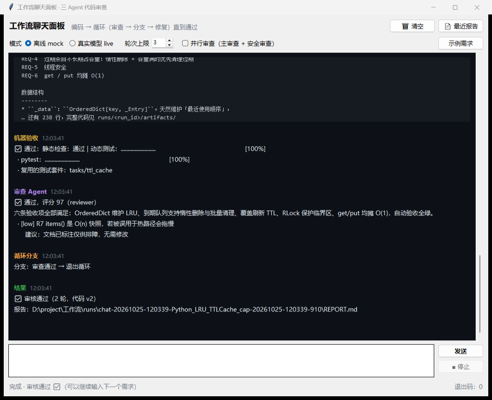
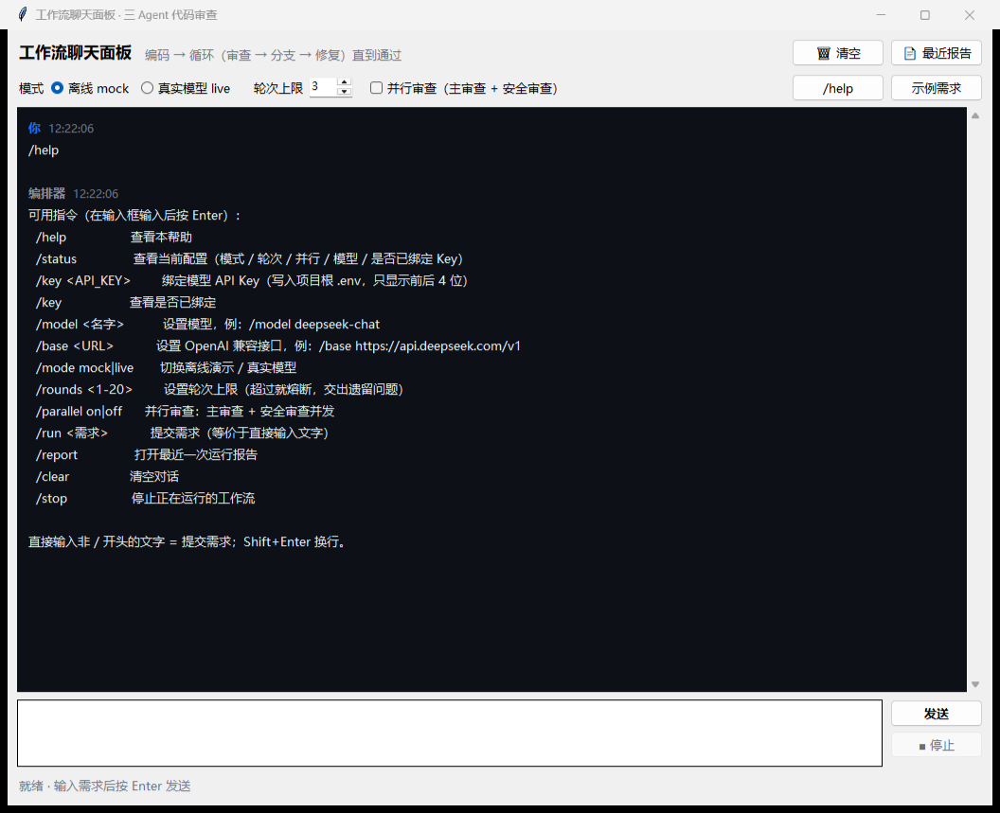
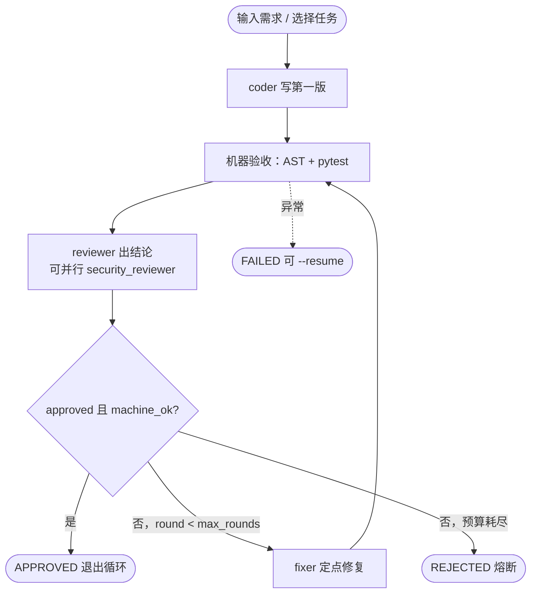
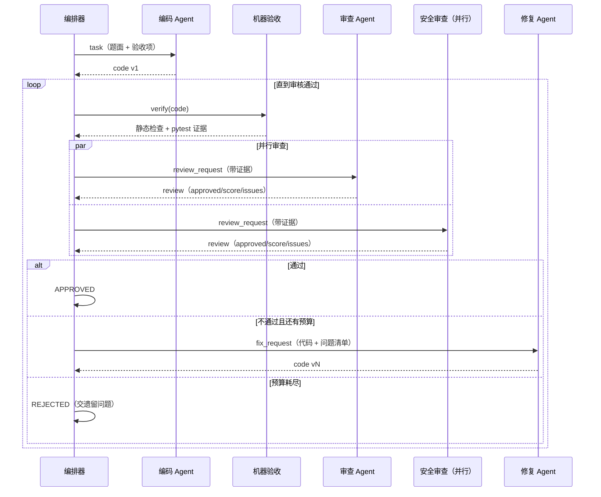
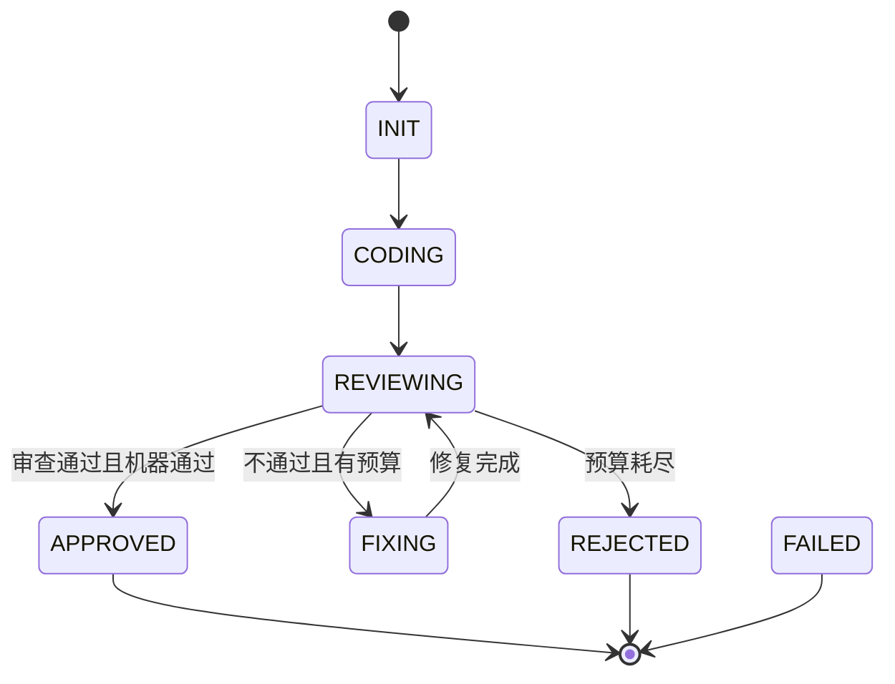

# 三 Agent 代码审查工作流（聊天式入口 · 循环直到审核通过）

一个**能真跑**的多 Agent 协作 Workflow：你输入一句需求，编码 Agent 写第一版 →
**循环体**里「审查 → 条件分支 → 定点修复」反复执行，**直到代码审核通过**（或轮次预算耗尽熔断）。
带消息总线、状态机、循环轨迹、事件流、并行审查、断点续跑和全链路决策记录（DEC），
并用它完成了验收题「带过期时间的 LRU 缓存」。

入口有两个，同一套代码：**双击 `WorkflowPanel.exe` 打开聊天面板**（输入需求 → 看它跑到通过），
或命令行 `python -m workflow.cli`。

[](tests/)
[](#42-循环体直到代码审核通过)
[](#13-第一次运行30-秒)
[](DECISIONS.md)



> 交付物：**README.md**（本文件：环境搭建、使用方法、技术方案）、**[Design.md](Design.md)**（设计文档）、
> **[DECISIONS.md](DECISIONS.md)**（决策记录）、`solutions/` + `tests/`（验收题实现与用例）、
> `WorkflowPanel.exe`（聊天式桌面入口）。

---

## 目录

- [一、环境搭建与快速开始](#一环境搭建与快速开始)
  - [1.1 环境要求](#11-环境要求)
  - [1.2 安装依赖](#12-安装依赖)
  - [1.3 第一次运行（30 秒）](#13-第一次运行30-秒)
  - [1.4 验证环境](#14-验证环境)
  - [1.5 重新打包 exe](#15-重新打包-exe)
  - [1.6 环境问题排查](#16-环境问题排查)
  - [1.7 一键脚本](#17-一键脚本)
- [二、项目结构](#二项目结构)
- [三、使用说明](#三使用说明)
- [四、技术方案](#四技术方案)
  - [4.2 循环体：直到代码审核通过](#42-循环体直到代码审核通过)
- [五、最终验收：带过期时间的 LRU 缓存](#五最终验收带过期时间的-lru-缓存)
- [六、决策记录（DEC）](#六决策记录dec)
- [七、已知限制](#七已知限制)

---

## 一、环境搭建与快速开始

### 1.1 环境要求

| 项 | 要求 | 说明 |
| --- | --- | --- |
| 操作系统 | Windows 10/11（64 位） | 双击面板需要；纯命令行/测试在 macOS、Linux 也能跑 |
| Python | 3.9+ | **只有源码方式需要**；双击 exe 不需要装 Python |
| 运行时依赖 | `requests>=2.31` | 调 LLM / GitHub 用，见 `requirements.txt` |
| 测试依赖 | `pytest>=7.4` | 机器验收与自测用 |
| 打包依赖（可选） | `pyinstaller` | 只在重新生成 exe 时需要 |
| 磁盘 | 约 100 MB | 依赖 + exe（23 MB）+ 每次运行的 `runs/` |

**需要 `AGENT_API_KEY`**（面板已禁用离线模式）。首次使用在面板里 `/bind sk-xxxxxxxx` 绑定，
`/test` 自检全绿后再输入需求；Key 只写本地 `.env`，不入库、不回显完整值。
（离线演示仅保留在命令行：`python -m workflow.cli run --task ttl_cache --mock`，不需要 Key。）

### 1.2 安装依赖

**方式 A：不安装，直接双击（推荐给演示/评审）**

```
双击 WorkflowPanel.exe   →  在聊天框里输入需求（例：用 Python 写一个带过期时间的 LRU 缓存 TTLCache）
```

exe 里已打包 Python、`requests`、`pytest` 以及 `tasks/ tests/ mock/ config/`，目标机器无需装 Python。
仓库里已带这份产物（`WorkflowPanel.exe`，约 23 MB）；若它缺失或版本落后，见 [1.5 重新打包](#15-重新打包-exe)。

**方式 B：源码方式（推荐给开发/调试）**

```powershell
cd <仓库根>
python -m pip install -r requirements.txt
```

> Windows 自带的「应用商店版 python.exe」是空壳，`python --version` 没输出时用它跑不起来：
> 用 `py -3`，或设置 `PYTHON` 指向真实解释器（`setx PYTHON "C:\Python312\python.exe"`）。
> 仓库内所有脚本都会自动探测解释器，不需要改代码。

### 1.3 第一次运行（30 秒）

**A. 聊天面板**：双击 `WorkflowPanel.exe` → 输入框里写需求（或点「示例需求」）→ 按 **Enter** 或点「发送」。

> 输入 `/help` 可以看全部指令；首次使用：`/bind sk-xxxxxxxx` 绑定 Key → `/test` 自检 → 直接输入需求（面板已禁用离线模式）。

面板会实时把工作流画成一段对话：

```
你        用 Python 写一个带过期时间的 LRU 缓存 TTLCache…
编码 Agent  初版代码 · v1（36 行）+ 代码预览
机器验收    ❌ 未通过：静态检查（线程安全）| pytest 8 failed
审查 Agent  ❌ 不通过，评分 42 · [critical] R1 完全没有加锁 …（逐条问题 + 建议）
循环分支    不通过 → 派修复，回到循环开头
修复 Agent  修复后的代码 · v2（253 行）
机器验收    ✅ 通过：静态检查 ✅ · pytest 25 passed（复用 tasks/ttl_cache 的测试）
审查 Agent  ✅ 通过，评分 97
结果        ✅ 审核通过（2 轮，代码 v2）· 报告路径
```

**B. 命令行**：

```powershell
# 聊天式：一句话需求（无需先建 tasks/ 目录）
python -m workflow.cli run --prompt "用 Python 写一个带过期时间的 LRU 缓存" --mock

# 跑内置任务（带 25 个测试）
python -m workflow.cli run --task ttl_cache --mock
```

预期输出（真实运行记录，节选）：

```
[workflow] 循环第 1 次：审查 → 条件分支
[workflow] 自动验收：静态检查：未通过(线程安全（锁）) | 动态测试：8 failed, 2 passed, 15 errors
[reviewer] 结论：不通过，评分 42，问题 6 条
[workflow] 分支：派修复，回到循环开头（llm_approved=False，machine_ok=False，round=1/3）
[workflow] 循环第 2 次：审查 → 条件分支
[workflow] 自动验收：静态检查：通过 | 动态测试：25 passed in 0.17s
[reviewer] 结论：通过，评分 97，问题 1 条
[workflow] 分支：放行，退出循环（llm_approved=True，machine_ok=True，round=2/3）
结果   : APPROVED  （2/3 轮）
```

一次运行产出在 `runs/<run_id>/`：`state.json`（含 `loop_trace`）、`messages.jsonl`、
`decisions.jsonl`、`REPORT.md`、`artifacts/`。报告怎么读见 [4.3](#33-产物与报告)。

### 1.4 验证环境

```powershell
python -m pytest -q                              # 64 passed（25 缓存 + 5 循环 + 21 面板 + 3 聊天 + 3 并行 + 3 扩展 + 4 契约）
python -m workflow.cli verify --task ttl_cache   # ✅ 通过（25 passed）
```

用面板也可以点 **✅ 只验收**，等价于第二条命令。

### 1.5 重新打包 exe

改了代码后，产物不会自动更新，需要重新打包（约 1 分钟）：

```powershell
powershell -NoProfile -ExecutionPolicy Bypass -File .\scripts\build_exe.ps1
# 产物：WorkflowPanel.exe（约 23 MB）
```

- 打包配置：`launcher.spec`（单文件，含 `tasks/tests/mock/config` 与 pytest）
- **`.env` 不进包**：`datas` 只列了 `tasks / tests / mock / config / solutions / conftest.py / pytest.ini / requirements.txt`，
  模型 Key 是运行时从 exe 旁边的 `.env` 读的，构建产物里不含 Key（可用 `strings` 搜 `sk-` 验证）
- `pyinstaller-hooks/hook-workflow.py`：覆盖社区同名 hook（PyPI 上也有个 `workflow` 包），否则打包报错
- `WorkflowPanel.exe` 随仓库一起提交（约 23 MB），评审可直接双击；`build/` 是中间目录，不入库

没有 Python 环境时，可以先在有 Python 的机器上执行上面的命令，再把 `WorkflowPanel.exe` 拷过去。

### 1.6 环境问题排查

| 现象 | 原因 | 处理 |
| --- | --- | --- |
| `未找到可用的 Python 3 解释器` | PATH 上没有真实解释器 | `setx PYTHON "C:\Python312\python.exe"`，或脚本传 `-Python <路径>` |
| `缺少 API Key：在 .env 里设置 AGENT_API_KEY` | 用了 `--live` 但没有 Key | 面板里 `/bind sk-xxxx` 绑定，然后 `/test` 自检；命令行见 `.env.example` |
| 输入 `/help` 却被当成需求去跑工作流 | 打开的是**旧窗口**（exe 更新前启动的进程） | 面板里 `/version` 看构建时间；关掉面板重新双击 `WorkflowPanel.exe` |
| 想知道 exe 是不是最新 | — | 命令行 `WorkflowPanel.exe --version`，或 `--selftest`（输出 `slash-commands: OK`） |
| 终端输出中文乱码 | 控制台编码不是 UTF-8 | `$env:PYTHONIOENCODING = "utf-8"`；`.ps1` 脚本已是 UTF-8 BOM |
| 双击 exe 没反应 / 被 SmartScreen 拦 | 未签名的新 exe | 右键属性 → 解除锁定；或用 `WorkflowPanel.cmd` 启动 |
| 面板启动后立即退出 | 缺文件或被拦截 | 用命令行跑 `WorkflowPanel.exe --cli tasks` 看是否报错 |
| 面板报「找不到任务」 | exe 被单独拷到了无源码的目录 | 设 `WORKFLOW_HOME` 指向仓库根；或把 exe 放回仓库根目录 |
| 打包失败，提示 `hook-workflow.py` | 社区 hook 与本地 `workflow` 包冲突 | 确认 `launcher.spec` 的 `hookspath` 指向 `pyinstaller-hooks/`（已配置） |

更多排错见 [docs/runbook.md](docs/runbook.md) 第 8 节。

### 1.7 一键脚本

都在 `scripts/`，自动探测解释器、自动切到仓库根，脚本内没有绝对路径：

```powershell
powershell -NoProfile -ExecutionPolicy Bypass -File .\scripts\verify.ps1     # 一键验收（pytest + verify）
powershell -NoProfile -ExecutionPolicy Bypass -File .\scripts\demo.ps1       # 一键演示（verify + mock run）
powershell -NoProfile -ExecutionPolicy Bypass -File .\scripts\build_exe.ps1  # 一键打包 exe
powershell -NoProfile -ExecutionPolicy Bypass -File .\scripts\push.ps1 -DryRun  # 一键上传预览（可选）
```

---

## 二、项目结构

```
.
├── README.md                 ← 你正在看（环境搭建 + 使用方法 + 技术方案）
├── Design.md                 设计文档（分层 / 循环体 / 状态机 / 错误恢复）
├── DECISIONS.md              项目级决策索引（19 条）
├── requirements.txt / .gitignore / .env.example / conftest.py / pytest.ini
│
├── core/                     基础设施
│   ├── paths.py              应用根目录解析（源码 / exe / WORKFLOW_HOME）
│   ├── llm_client.py         OpenAI 兼容 + mock provider + 解析容错
│   ├── bus.py                消息总线（收件箱 + JSONL 落盘）
│   ├── state.py              状态机 / 迁移白名单 / 原子落盘 / loop_trace
│   ├── dec.py                DEC 记录器（自动编号、索引重建）
│   ├── verify.py             AST 静态检查 + pytest 执行
│   └── doctor.py             链路自检（/test 的后端：文件/配置/Key/网络/pytest）
│
├── agents/                   三个 Agent（无状态，只认消息）
│   ├── base.py               共同骨架（收件箱 / 回复 / Prompt）
│   ├── coder.py              编码
│   ├── reviewer.py           审查（含强制驳回保险）
│   ├── registry.py           ★ Agent 注册表 + 配置驱动流水线
│   └── fixer.py              修复
│
├── workflow/                 编排层
│   ├── orchestrator.py       ★ 循环体（审查 → 分支 → 修复）+ 状态机 + 决策点
│   ├── task.py               任务定义
│   ├── report.py             REPORT.md 生成（含循环轨迹表）
│   └── cli.py                命令行
│
├── launcher/                 ★ 桌面启动面板
│   ├── app.py                入口：GUI / --cli / --pytest 三种模式
│   └── panel.py              Tkinter 面板（子进程 + 实时日志 + 状态栏）
├── launcher.spec             PyInstaller 打包配置
├── pyinstaller-hooks/        覆盖社区 hook-workflow（与本地同名包冲突）
├── assets/workflow.ico       面板图标（scripts/make_icon.py 生成）
├── WorkflowPanel.exe    ★ 打包产物（随仓库提交，约 23 MB，双击即用）
├── WorkflowPanel.cmd         双击入口（转发到 WorkflowPanel.exe）
│
├── tasks/ttl_cache/          任务：题面 / 验收项 / 元信息
├── solutions/ttl_cache.py    ★ 验收题实现
├── tests/
│   ├── test_ttl_cache.py     25 个缓存验收用例
│   ├── test_workflow_loop.py 5 个循环体用例（重复 / 熔断 / 机器优先 / 双阶段续跑）
│   ├── test_launcher_panel.py 20 个聊天面板用例（命令拼装 / 发送 / 事件渲染 / 状态 / 斜杠指令）
│   ├── test_prompt_mode.py   3 个聊天模式用例（一次性任务 / 测试推断 / 事件流）
│   └── test_extensibility.py 3 个扩展性用例（注册新 Agent / 配置换流水线）
├── mock/                     离线场景数据（故意留坑的初稿 + 修复稿）
├── docs/
│   ├── runbook.md            运行手册（命令 / 产物 / 排错 / 换机器 / 打包）
│   ├── architecture.md       架构说明（分层 / 循环 / 状态机 / 扩展）
│   ├── assets/chat.png       聊天面板截图
│   ├── assets/help.png       /help 指令截图
│   └── decisions/DEC-*.md    19 条项目级决策正文
├── examples/sample-run/      一次完整运行的真实产出
└── scripts/                  包装脚本（自动探测解释器，无绝对路径）
    ├── _env.ps1              公共探测：Python / 仓库根 / 上传工具
    ├── demo.ps1              一键演示
    ├── verify.ps1            一键验收
    ├── build_exe.ps1         一键打包 exe
    ├── make_icon.py          重新生成图标
    └── push.ps1              一键上传（调用外部 ghpush）
```

---

## 三、使用说明

### 3.1 命令与参数

```powershell
# 聊天式：一句话需求，不需要先建 tasks/ 目录（可与 --mock / --live 组合）
python -m workflow.cli run --prompt "用 Python 写一个带过期时间的 LRU 缓存" --mock
python -m workflow.cli run --prompt-file .\需求.md --live --rounds 3 --parallel-review

# 内置任务
python -m workflow.cli run --task ttl_cache --mock
python -m workflow.cli run --task ttl_cache --live --apply      # 通过后写入 solutions/
python -m workflow.cli verify --task ttl_cache                  # 只跑双层验收，不起 Agent
python -m workflow.cli tasks / runs                             # 列出任务 / 历史运行
python -m workflow.cli run --task ttl_cache --resume --run-id <id>
```

| 参数 | 作用 |
| --- | --- |
| `--mock` / `--live` | 离线脚本化 / 真实模型（需 `AGENT_API_KEY`） |
| `--prompt "…"` / `--prompt-file <md>` | 聊天模式：把这句话/这个文件当成一次性任务（无需 `tasks/`） |
| `--events` | 输出 JSONL 事件流（面板与脚本消费；`session/code/verification/review/loop/done`） |
| `--parallel-review` | 并行审查：主审查 + 安全审查两个 Agent 同时跑，结论取交集 |
| `--rounds N` | 覆盖轮次上限（默认 3） |
| `--apply` | 仅 `APPROVED` 时把产物写入 `solutions/` |
| `--no-dynamic-verify` | 只做静态检查，跳过 pytest（调试用） |
| `--resume --run-id <id>` | 从 `state.json` 续跑 |
| `--config` / `--model` / `--base-url` | 覆盖配置 |
| `--quiet` | 少打印 |

### 3.2 聊天面板操作

| 控件 | 作用 |
| --- | --- |
| 输入框 + 发送（Enter） | 把需求发给工作流；`Shift+Enter` 换行，跑完可以继续发下一条 |
| 示例需求 / `/help` | 一键填入示例需求 / 查看全部斜杠指令 |
| 模式 / 轮次上限 | 对应 `--mock`·`--live` / `--rounds` |
| 并行审查 | 对应 `--parallel-review`（主审查 + 安全审查并发） |
| ■ 停止 | 杀掉整个子进程树，状态已落盘，可稍后 `--resume` |
| 📄 最近报告 / 🗑 清空 | 打开最新 `REPORT.md` / 清空对话 |
| 状态栏 | 结束状态与退出码（0 通过 / 1 未通过 / 其它异常） |

**斜杠指令**（在输入框直接输入 `...` 后按 Enter）：



| 指令 | 作用 |
| --- | --- |
| `/help` | 查看全部指令 |
| `/bind <API_KEY>` | **绑定 API Key**：写入项目根 `.env` 的 `AGENT_API_KEY`，回显只显示前后 4 位 |
| `/bind` | 查看是否已绑定（脱敏显示） |
| `/unbind` | **解绑**：从 `.env` 删除 `AGENT_API_KEY` |
| `/test` | **链路自检**：文件 / 运行目录 / 配置 / Key / 模型连通 / pytest / 事件流，逐项给出结果与修复建议 |
| `/model <名字>` | 设置模型，如 `/model deepseek-chat` |
| `/base <URL>` | 设置 OpenAI 兼容接口，如 `/base https://api.deepseek.com/v1` |
| `/rounds <1-20>` | 设置轮次上限（超限熔断并交出遗留问题） |
| `/parallel on\|off` | 并行审查开关 |
| `/status` | 查看当前配置：轮次 / 并行 / Key（脱敏）/ 模型 / 接口 |
| `/run <需求>` | 提交需求（等价于直接输入文字） |
| `/report` | 打开最近一次运行报告 |
| `/version` | 查看面板构建时间（确认没在跑旧 exe） |
| `/clear` / `/stop` | 清空对话 / 停止运行 |

> **离线 mock 已在面板中禁用**：面板固定走真实模型，没有 Key 就跑不了（`/mode` 会提示已禁用）。
> 首次使用：`/bind sk-xxxx` → `/test`（全绿再开始）→ 直接输入需求。
> Key 只写进 `.env`（已在 `.gitignore` 中），不会出现在对话、日志与报告里。
> 离线演示仍可用命令行：`python -m workflow.cli run --task ttl_cache --mock`。

面板把每条事件翻译成对话，所以能直接看到「初版代码 → 机器验收 → 审查意见 → 分支 → 修复 → 再审 →
通过」的完整链路；代码只显示前 14 行，完整体在 `runs/<run_id>/artifacts/`。

### 3.3 产物与报告

每次运行写在 `runs/<run_id>/`：

```
runs/<run_id>/
├── state.json          状态真相源（阶段 / 轮次 / 代码 / 审查结论 / loop_trace）
├── messages.jsonl      全部 Agent 消息（按 seq 有序）
├── decisions.jsonl     运行级 DEC 正文
├── DECISIONS.md        运行级 DEC 索引表
├── REPORT.md           一页式报告 ← 先看这个
├── artifacts/          v1-coder.py、v2-fixer.py、latest.py
└── workspace/          跑 pytest 的干净工作区（每轮重建）
```

`REPORT.md` 有七节：验收结果、审查记录、**循环轨迹**、DEC、通信流水、模型调用、最终代码。
「循环轨迹」回答「第几次、LLM 怎么判、机器怎么判、走了哪个分支」。
样例：[examples/sample-run/REPORT.md](examples/sample-run/REPORT.md)。

### 3.4 mock 与 live 的区别（别误读）

| | mock | live |
| --- | --- | --- |
| 验证什么 | 编排、状态机、通信、验收、DEC、报告**全部真实** | 上述全部 + **模型真实能力** |
| 结论怎么来 | `mock/` 下的脚本化内容 | 真实模型输出 |
| 需要 Key | 否 | 是 |
| 代码路径 | 与 live 完全相同，只换 provider | 同左 |

mock 是「编排逻辑的单元测试」，不能作为「模型能写出好代码」的证据。

---

## 四、技术方案

### 4.1 总体架构

```
┌────────────────────────────────────────────────────────────────┐
│ launcher/  桌面入口（可选）                                       │
│   app.py  GUI / --cli / --pytest 三模式    panel.py  Tkinter 面板  │
├────────────────────────────────────────────────────────────────┤
│ workflow/  编排层                                                │
│   orchestrator.py   循环体 + 状态机 + 轮次预算 + 验收把关 + DEC   │
│   task.py           任务定义    report.py  REPORT.md 生成         │
├────────────────────────────────────────────────────────────────┤
│ agents/    Agent 层（无状态，只认消息）                            │
│   coder.py 编码    reviewer.py 审查    fixer.py 修复             │
├────────────────────────────────────────────────────────────────┤
│ core/      基础设施                                              │
│   llm_client.py OpenAI 兼容 + mock   bus.py 消息总线             │
│   state.py 状态机 + 原子落盘          dec.py DEC 记录器           │
│   verify.py AST + pytest 验收        paths.py 根目录解析          │
└────────────────────────────────────────────────────────────────┘
```

依赖方向单向：`launcher → workflow → agents → core`，`core` 不 import 上层。
所以 Agent 可以脱离编排器单独喂消息测试。

### 4.2 循环体：直到代码审核通过

**核心结构**：不再把「编码 → 审查 → 修复」写成一次性的直线调用，而是收进一个 `while`。
整个流程的主结构就是 `workflow/orchestrator.py` 的 `_loop_until_approved()`：

```python
while state.phase == Phase.REVIEWING:
    verdict = self._phase_review(state)            # ① 审查 + 条件分支
    self._trace_loop(state, round_no, verdict)     # ② 本轮结果记账（loop_trace）
    if verdict != VERDICT_RETRY:
        break                                      # ③ 通过 / 预算耗尽 → 离开循环
    self._phase_fix(state)                         # ④ 未通过 → 修复 → 回到 while 条件
```

| 分支 | 条件 | 动作 | 去向 |
| --- | --- | --- | --- |
| `approved` | 审查通过 **且** 机器验收通过 | 记 DEC、落盘 | `APPROVED`，**离开循环** |
| `retry` | 不通过（或机器不通过被强制驳回），且 `round < max_rounds` | 记 DEC、派修复 | 修复后**回到循环开头** |
| `rejected` | 不通过，且 `round >= max_rounds` | 记 DEC、熔断 | `REJECTED`，**离开循环** |
| （异常） | 调用 / 解析 / 验收抛异常 | 记 DEC | `FAILED`，可 `--resume` |

每轮追加一条 `state.loop_trace` 记录（`iteration / round / approved / machine_ok / score /
issues / verdict / action`），报告里的「循环轨迹」表由它渲染：

```
| 第几次 | 轮次 | LLM 结论 | 机器验收 | 评分 | 问题数 | 分支动作           |
| 1      | 1    | 驳回     | ❌       | 42   | 6      | 派修复，回到循环开头 |
| 2      | 2    | 通过     | ✅       | 97   | 1      | 放行，退出循环       |
```

为什么不用「单次调用」：

- **判据是活的条件，不是固定步数**。「通过了吗」只有跑完这一轮才知道，固定顺序调用
  N 个 Agent 无法表达「直到通过为止」。
- **修复必须能触发再审查**。单次调用里修复是终点；循环体里修复只是让条件重新求值的一步。
- **代价可控**：循环有明确上界（`max_rounds`），不是 `while True` 死等。

取舍与代价见 [DEC-014](docs/decisions/DEC-014-review-loop.md)。

### 4.3 状态机

> 循环体负责「要不要再来一轮」，状态机负责「这次迁移合不合法」。

```
INIT ──▶ CODING ──▶ REVIEWING ──┬─▶ APPROVED        （审查过 + 机器验收过）
                                ├─▶ FIXING ──▶ REVIEWING（审查不过，还有预算）
                                └─▶ REJECTED        （审查不过，预算耗尽）
任意阶段 ──异常──▶ FAILED
```

迁移走白名单（`Phase.TRANSITIONS`），`REVIEWING → CODING` 这类跳转直接抛
`IllegalTransition`。设计理由见 [DEC-004](docs/decisions/DEC-004-state.md)。

### 4.4 消息协议

| kind | 方向 | 关键载荷 |
| --- | --- | --- |
| `task` | 编排器 → 编码 | `task_spec`、`requirements`、`target_file` |
| `code` | 编码/修复 → 编排器 | `code`、`notes`、`addressed` |
| `review_request` | 编排器 → 审查 | `code`、`requirements`、`test_contract`（验收契约）、**`verification`（机器验收证据）** |
| `review` | 审查 → 编排器 | `approved`、`score`、`issues[]`、`summary` |
| `fix_request` | 编排器 → 修复 | `code`、`issues[]`、`test_contract`、`verification`（原始 pytest 报错） |
| `status` / `done` / `failed` | 编排器 → 全部 | `phase`、`round` |

所有消息按序写入 `runs/<run_id>/messages.jsonl`，报告里渲染成「通信流水」表
（[DEC-003](docs/decisions/DEC-003-message-bus.md)）。

### 4.5 双层验收

```
state.code
   │
   ├─▶ 静态检查（AST）：类/方法签名、是否真用 with self._lock、get/put 内有无全表扫描
   ├─▶ 动态验收：干净工作区 + pytest（25 个用例）
   └─▶ 作为「证据」塞进审查 Prompt ──▶ LLM 出 JSON 结论
                                        │
                     approved 且 machine_ok ──▶ APPROVED
                     approved 但机器红     ──▶ 强制驳回 + 记一条 DEC
```

三层保险：Prompt 层给证据、`normalize_review` 层改模型结论、编排器层守终态
（[DEC-006](docs/decisions/DEC-006-machine-verdict.md)）。冲突时**以机器为准**。

**验收契约（`Task.contract_text`）**：光给「验收项」不够——测试里怎么写调用，
代码就得长什么样。所以编码 / 修复 / 审查 Agent 的 Prompt 里都带上真正会跑的
pytest 源码，外加从测试里自动抽出的接口清单：

```
- 构造签名必须接受这些关键字参数：TTLCache(capacity=..., ttl_seconds=..., clock=...)
- 实例上会出现这些方法调用：put, get, items, stats, clear, purge_expired
- 测试会直接读这些内部属性（名字不能改）：_expiry
```

修复 Agent 还会拿到上一轮 pytest 报错的**开头与结尾**（第一个失败用例的完整 traceback +
失败清单）：只给它「构造函数 TypeError」这种转述，它只能照着措辞猜，改不动真正的签名。

### 4.6 三个 Agent

| Agent | 文件 | 职责 | 输入 | 输出 | 温度 |
| --- | --- | --- | --- | --- | --- |
| 编码 Agent | `agents/coder.py` | 按任务说明写第一版完整实现 | `task` 消息（需求 + 验收项 + 验收契约） | 一个 python 代码块 + 说明 | 0.1 |
| 审查 Agent | `agents/reviewer.py` | 逐条对照 REQ 审查，输出结构化结论 | `review_request`（代码 + 契约 + 验收证据） | 严格 JSON | 0.0 |
| 修复 Agent | `agents/fixer.py` | 只改被指出的问题，保持结构 | `fix_request`（代码 + 问题清单 + 契约 + pytest 报错） | 完整代码块 + 「已修复」清单 | 0.1 |

共同点：**无状态、无文件系统访问、只读写收件箱**。换模型只改 `config/agents.json`：

```json
{ "provider": "openai", "base_url": "https://api.deepseek.com/v1",
  "model": "deepseek-chat",
  "agents": { "reviewer": { "temperature": 0.0 }, "coder": { "temperature": 0.1 } } }
```

### 4.7 固定工具：GitHub 上传（可选）

`git` 不在 PATH 的机器上，用独立目录的 `ghpush.py` 上传（REST API，一次一个原子 commit）：

```powershell
python "$env:GH_PUSH_HOME\ghpush.py" --dir . -m "feat: 三 Agent 工作流"
powershell -NoProfile -ExecutionPolicy Bypass -File .\scripts\push.ps1 -DryRun
```

工具位置由 `GH_PUSH_HOME` 指定、不写死（[DEC-010](docs/decisions/DEC-010-github-tool.md)、
[DEC-013](docs/decisions/DEC-013-portability.md)）。

### 4.8 聊天入口、事件流与并行审查

**聊天输入 = 一次性任务**。面板把输入写进 `runs/_prompts/<id>/task.md` 后调用
`run --prompt-file … --events`。
如果这句话里已经点名了某个已知任务的类名（典型场景：「写一个带过期时间的 LRU 缓存 …
class TTLCache」），`Task.from_prompt` 会**在编码之前**就沿用 `tasks/ttl_cache` 的
模块名、验收项与 25 个用例——接口契约随首轮 Prompt 一起给到 Agent，
面板与报告会标出「复用的测试套件」。完全无关的需求（如「写两个小函数」）没有固定类名，
静态检查退化为「通用检查」（语法、非空、无占位），也没有契约可给。

**事件流**（`--events`）让 UI 与编排解耦：

```json
{"type":"session","provider":"mock","max_rounds":3,"parallel_review":false}
{"type":"code","agent":"coder","version":1,"lines":36,"code":"class TTLCache: …"}
{"type":"verification","passed":false,"checks":[…],"pytest":"8 failed","tests_from":"ttl_cache"}
{"type":"review","approved":false,"score":42,"issues":[…],"agents":["reviewer"]}
{"type":"loop","verdict":"retry","action":"派修复，回到循环开头"}
{"type":"done","phase":"APPROVED","round":2,"report":"runs/<run_id>/REPORT.md"}
```

面板只做「事件 → 对话」的翻译，所以 CLI、脚本、GUI 看到的是同一份事实。

**并行审查**（`--parallel-review`）：`_run_reviewers()` 把「主审查」和「安全审查」两个 Agent
放进线程池并发执行，join 后合并 —— 都通过才放行、问题取并集、分数取最低。
默认关闭以免每轮多花一次模型调用（[DEC-016](docs/decisions/DEC-016-chat-entry.md)）。

### 4.9 流程图

**主流程（循环体）**



**Agent 协作时序**



**状态机**



---

## 五、最终验收：带过期时间的 LRU 缓存

### 5.1 交付物

- 实现：[`solutions/ttl_cache.py`](solutions/ttl_cache.py)（约 300 行，含设计注释）
- 测试：[`tests/test_ttl_cache.py`](tests/test_ttl_cache.py)（25 个用例，0.17s 跑完）
- 结果：`python -m pytest -q` → **64 passed**（其中缓存 25 个）
- 由工作流自己跑一遍：面板输入「写一个带过期时间的 LRU 缓存，线程安全」→
  第 1 轮验收失败 → 修复 → 第 2 轮 `25 passed` → APPROVED（报告见 `runs/<run_id>/REPORT.md`）

### 5.2 六条要求怎么满足

| 要求 | 实现 | 对应测试 |
| --- | --- | --- |
| **REQ-1** 容量满淘汰最久未使用 | `OrderedDict` + `move_to_end()` / `popitem(last=False)`，两者 O(1) | `test_evicts_least_recently_used`、`test_get_updates_recency` |
| **REQ-2** TTL 过期，get 视为不存在且移除 | 命中过期分支执行 `del self._data[key]`（惰性删除），而不是只返回 None | `test_expired_entry_is_miss_and_removed`、`test_entry_expires_exactly_at_ttl` |
| **REQ-3** put 覆盖刷新 TTL | 覆盖分支同时刷新 `value` / `expire_at` / `version`，并 `move_to_end` | `test_put_existing_refreshes_ttl` |
| **REQ-4** 过期不长期占容量 | 写入前 `_purge_expired()` 批量清理队首到期条目，仍满才淘汰 LRU；另提供 `purge_expired()` | `test_expired_entries_do_not_block_new_writes`（断言 `evictions == 0`） |
| **REQ-5** 线程安全 | `threading.RLock` + `with` 临界区，统计计数也在锁内 | `test_concurrent_read_write_does_not_break_invariants`、`test_concurrent_put_never_exceeds_capacity` |
| **REQ-6** get/put 均摊 O(1) | 哈希定位 O(1) + 到期双端队列 O(1) 弹出；无排序、无全表扫描 | `test_put_many_with_small_capacity_is_fast`、`test_expiry_queue_stays_bounded` |

### 5.3 为什么这么设计（DEC-007 / DEC-008）

难点在「怎么 O(1) 找到过期条目」：

| 方案 | 单次复杂度 | 结论 |
| --- | --- | --- |
| 每次扫描全表 | O(n) | ❌ 直接违反 REQ-6 |
| 最小堆存到期时间 | O(log n) | ⚠️ 严格口径不算 O(1)，实现也重 |
| **OrderedDict + 到期双端队列 + 版本号** | **均摊 O(1)** | ✅ 本方案 |

关键洞察：**TTL 全局固定 + 单调时钟** ⇒ 入队顺序天然等于到期顺序，队首就是最早到期，
不需要堆。条目带 `version`，覆盖刷新或淘汰后旧队列记录自动失效；队列长度超过
`2*capacity+32` 时压缩一次，摊销后仍是均摊 O(1)。

### 5.4 测试为什么不 flaky

不用 `sleep` 做语义测试，而是**注入假时钟**（`clock` 参数 + `FakeClock`），TTL 用例全部
「推进时间」而非「等待时间」。复杂度用两条稳定断言：容量 8 vs 20000 的耗时比值（宽松 8 倍
阈值，抓数量级退化）+ 内部队列长度上界（[DEC-009](docs/decisions/DEC-009-testing-approach.md)）。

---

## 六、决策记录（DEC）

每次决策都留编号。分两层：**项目级 19 条**（正文在 `docs/decisions/`）+ **运行级**
（每次运行自动编号，写入 `runs/<id>/decisions.jsonl`，汇总进 `REPORT.md`）。

| 编号 | 主题 | 决定 |
| --- | --- | --- |
| [DEC-001](docs/decisions/DEC-001-tech-stack.md) | 技术栈 | 标准库 + requests，不用编排框架 |
| [DEC-002](docs/decisions/DEC-002-topology.md) | 拓扑 | 三 Agent，定点修复而非重写 |
| [DEC-003](docs/decisions/DEC-003-message-bus.md) | 通信 | 收件箱总线 + JSONL |
| [DEC-004](docs/decisions/DEC-004-state.md) | 状态 | 单一状态源 + 原子落盘 + 迁移白名单 |
| [DEC-005](docs/decisions/DEC-005-llm.md) | 模型 | OpenAI 兼容 + 配置化 + mock |
| [DEC-006](docs/decisions/DEC-006-machine-verdict.md) | 验收 | 机器优先于 LLM |
| [DEC-007](docs/decisions/DEC-007-ttlcache-data-structure.md) | 结构 | OrderedDict + 到期队列，弃堆 |
| [DEC-008](docs/decisions/DEC-008-expiry-policy.md) | 过期 | 惰性删除 + 容量满优先清理，无线程 |
| [DEC-009](docs/decisions/DEC-009-testing-approach.md) | 测试 | 假时钟 + 上界 + 比值 |
| [DEC-010](docs/decisions/DEC-010-github-tool.md) | 上传工具 | 固化目录 + REST API |
| [DEC-011](docs/decisions/DEC-011-round-budget.md) | 预算 | 3 轮熔断 |
| [DEC-012](docs/decisions/DEC-012-traceability.md) | 可追溯 | 运行级 DEC + 自动报告 |
| [DEC-013](docs/decisions/DEC-013-portability.md) | 可移植 | 零绝对路径 + 两个环境变量 |
| [DEC-014](docs/decisions/DEC-014-review-loop.md) | 流程控制 | 显式循环体直到审核通过，三种出口 + 循环轨迹 |
| [DEC-015](docs/decisions/DEC-015-desktop-launcher.md) | 桌面入口 | 单文件 exe + 三子命令，根目录统一解析 |
| [DEC-016](docs/decisions/DEC-016-chat-entry.md) | 聊天入口 | `--prompt` 一次性任务 + `--events` 事件流 + 并行审查 |
| [DEC-017](docs/decisions/DEC-017-agent-registry.md) | 可扩展性 | Agent 注册表 + 配置驱动流水线，新增 Agent 不改编排器 |
| [DEC-018](docs/decisions/DEC-018-bind-doctor.md) | 绑定与自检 | 面板禁用离线；`/bind` `/unbind` 对称；`/test` 七项链路自检 |
| [DEC-019](docs/decisions/DEC-019-acceptance-contract.md) | 验收契约 | 测试源码 + 接口清单随 Prompt 下发；聊天任务编码前挂载已知套件 |

每条 DEC 都写了 **背景 / 可选项 / 决定 / 理由 / 代价与后果 / 复核条件**。

---

## 七、已知限制

1. **mock 不是模型能力证明**：它只证明编排正确，真实效果请 `--live`。
2. **测试决定上限**：机器验收只覆盖已写的 25 个缓存用例、5 个循环体用例、21 个面板用例、
   3 个聊天模式用例、3 个并行审查用例、3 个扩展用例与 4 个验收契约用例；
   没覆盖的行为，LLM 审查也未必发现。
3. **单机单写者**：同一 `run_id` 不能被两个进程同时续跑（无文件锁）。
4. **循环是顺序单步的**：一次迭代只跑一个审查 Agent，没有并行审查分支（[DEC-014](docs/decisions/DEC-014-review-loop.md)）。
5. **不支持 per-key TTL**：这是 [DEC-007](docs/decisions/DEC-007-ttlcache-data-structure.md) 里明确接受的代价。
6. **成本无精细控制**：轮次是唯一预算旋钮，没有 token 计费与限流。
7. **静态检查是启发式**：只把「锁、签名、类存在、语法」设为硬性，其余降级为警告。
8. **exe 是构建产物**：源码更新后要重跑 `scripts/build_exe.ps1` 才会同步到面板。
9. **跨机器要配环境变量**：`PYTHON`（解释器）、`GH_PUSH_HOME`（上传工具）、
   `WORKFLOW_HOME`（面板单独拷走时指定根目录），见 [DEC-013](docs/decisions/DEC-013-portability.md)。

---

## 附：相关链接

- **设计文档（分层 / 循环体 / 状态机 / 错误恢复 / 测试策略）**：[Design.md](Design.md)
- **运行手册（命令 / 产物 / 排错 / 换机器 / 打包）**：[docs/runbook.md](docs/runbook.md)
- **架构说明**：[docs/architecture.md](docs/architecture.md)
- **决策索引**：[DECISIONS.md](DECISIONS.md)
- **样例运行报告**：[examples/sample-run/REPORT.md](examples/sample-run/REPORT.md)
- 桌面入口决策：[DEC-015](docs/decisions/DEC-015-desktop-launcher.md)
- 聊天入口与并行审查：[DEC-016](docs/decisions/DEC-016-chat-entry.md)
- 扩展机制（注册表 + 流水线配置）：[DEC-017](docs/decisions/DEC-017-agent-registry.md)
- 绑定/解绑与链路自检：`/bind` `/unbind` `/test` — [DEC-018](docs/decisions/DEC-018-bind-doctor.md)
- 上传工具说明：`$env:GH_PUSH_HOME\README.md`（外部工具，按 DEC-010 独立维护）
